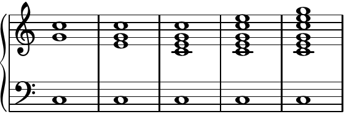
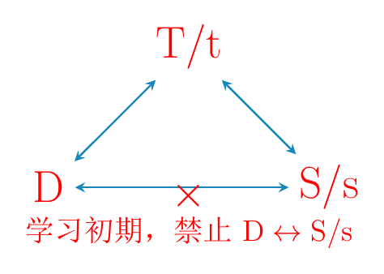
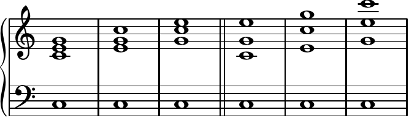

## 阶段一：正三和弦

### 四部和声 （详见第 1 课）

**重点提炼：**

1.  “四声部”既“简洁”又“饱满”，可适应绝大多数纵向框架。

    

    谱例顺序：二声部、三声部、**四声部**、五声部、六声部。 四声部位于二、三声部与五、六声部之间，兼具**简洁**与**饱满**。

2.  四部和声相关名词概念。

    | 音域称呼 | 人声称呼 | 声部编号 | 功能称呼 |
    | :--- | :--- | :--- | :--- |
    | 高声部 | 女高声部 | 一声部 | 旋律声部、外声部 |
    | 中声部 | 女低声部 | 二声部 | 内声部 |
    | 次中声部 | 男高声部 | 三声部 | 内声部 |
    | 低声部 | 男低声部 | 四声部 | 外声部 |

### 功能体系 （详见第 2、3 课）

**重点提炼：**

正三和弦 TSD（tsD），与其相互之间连接可行性：

| 功能 | 级数 | 标记 | 性格描述 |
| :--- | :--- | :--- | :--- |
| **主功能** | I 级 | **T/t** | “稳定，在家” |
| **属功能** | V 级 | **D** | “紧张，想家” |
| **下属功能** | IV 级 | **S/s** | “兴奋，刚出门” |

- $\mathrm{T/t}\leftrightarrow\mathrm{S/s}$：变格进行。

- $\mathrm{T/t}\leftrightarrow\mathrm{D}$：正格进行。

- $\mathrm{T/t}\rightarrow\mathrm{S/s}\rightarrow\mathrm{D}\rightarrow\mathrm{T/t}$：完全进行。

### 排列法 （详见第 4 课）

**重点提炼：**

1.  排列法分为三种：

    - 密集：上方三声部的相邻声部之间 $\leq$ 4 度。

    - 开放：上方三声部的相邻声部之间 $\geq$ 5 度。

    - 混合：待讲。

    图中谱例以 C 和弦示意：

    - **密集排列**：上方三声部的相邻声部之间 $\leq$ 四度。

    - **开放排列**：上方三声部的相邻声部之间 $\geq$ 五度。

    

    | **密集排列** | **开放排列** |
    | :--- | :--- |
    | 五音位置 / 根音位置 / 三音位置 | 三音位置 / 五音位置 / 根音位置 |

2.  “上密下疏，覆盖各音区”或“上密下疏中不空”。

    **“上方三声部的相邻声部之间不超过纯八度”（重要！）**

3.  XX 旋律位置（不用死记，了解这个词义即可）。

### 连接法 （详见第 5 课）

**重点提炼：**

1.  连接法分为两种：

    - 旋律连接法：四个声部均发生了改变。

    - 和声连接法：至少有一个声部未发生改变。

2.  连接法的核心是**“平稳”**，**“平稳”**就意味着“排列法”不会随意改变。

    在此阶段，仅能通过“同和弦转换（第 9 课）”与“三音跳进（第 11 课）”来改变“排列法”，除了这两种情况以外不要改变排列法。

### 需要注意的事 （详见第 3、4、5、6、12 课）

**重点提炼：**

1.  D 不能 $\rightarrow$ S/s（详见第 3 课）。

2.  上方三声部的相邻声部之间不超过纯八度（详见第 4 课）。

3.  原位正三和弦要重复根音（详见第 4 课，不重复根音的情况待讲）。

4.  “平稳进行”是基本原则（详见第 5 课）。

5.  **避免**“声部交叉、声部超越”（详见第 6 课）。

6.  **避免**“平行、反向、隐伏五八度”（详见第 6 课）。

7.  **避免**“四部同向”（详见第 6 课）。

8.  **避免**“和声切分”（详见第 12 课）。

以上任何一点若完全没有印象，则应当去相应课程复习。

### 常用、重要的技巧 （详见第 9、10、11、12 课）

**重点提炼：**

#### 同和弦转换 （详见第 9 课）

连续的和弦（两个或更多）都是同一个和弦，但纵向上的排列又不完全一样。

1.  声部进行超过三度完全可行。

    （其他诸如声部交叉超越、各种五八度、四部同向等问题依然是不能犯的。）

2.  更自由地调整各声部的纵向排列，以求更好地与前后和弦进行正确的连接。

3.  处理声部的“大跳进”。

#### 共同音保持 （详见第 10 课）

1.  突出正在改变的声部，削弱没有在改变的声部。

2.  在前期，主要把它做在“弱拍”的位置。

3.  可以把高声部的某一个（时值较长的）音视为“共同音保持”，为其配出多个和弦：

    1.  丰富和声进行。

    2.  调整声部的纵向排列。

#### 三音跳进 （详见第 11 课）

1.  发生在 $\mathrm{T/t}\leftrightarrow\mathrm{S/s}$ 或 $\mathrm{T/t}\leftrightarrow\mathrm{D}$ 之间的连接，$\mathrm{S}\rightarrow\mathrm{D}$ 不会发生。

2.  特征是会改变“排列法”。

3.  可发生在“高声部”与“次中声部”。

4.  小调的 $\mathrm{t}\leftrightarrow\mathrm{D}$ 之间发生的“三音跳进”要使用“减四度”进行。

#### “弱起”的配法 （详见第 12 课）

1.  在实践中，往往可以不配。

2.  在练习时，要配和弦（优先考虑配成 $\mathrm{D}\rightarrow\mathrm{T/t}$）。

    （若配不了 $\mathrm{D}\rightarrow\mathrm{T/t}$，再考虑其他配法，其他配法则无明显优先级区分，看自己主观喜好就好。）

#### 低音可跳“纯八度” （详见第 12 课）

- **作用 1：**用来处理“声部超越交叉、四部同向、隐伏五八度”等问题。

- **作用 2：**使得“低音旋律线条”的构建方式进一步丰富。

## 阶段二

### 正三和弦的六和弦 （详见第 13、14 课）

#### 自身纵向上的注意点

1.  “六和弦”有不止一种含义；本提纲采用“三和弦的第一转位”这一含义。

2.  转位数字写在功能标记的右下方，如 $\mathrm{T}_{6}$、$\mathrm{t}_{6}$、$\mathrm{S}_{6}$、 $\mathrm{s}_{6}$、$\mathrm{D}_{6}$。 六和弦仍属于原功能，但功能纯正度弱于对应的原位和弦，通常更适合过渡与铺垫。

3.  六和弦通常重复根音或五音；重复三音只用于课程指定的少数情形。

4.  六和弦中会出现**混合排列**：上方三声部的两个相邻音程中， 一个不超过四度，另一个不小于五度。

#### 横向连接的类型与重点

| **类型** | **1、$\mathrm{T}\leftrightarrow\mathrm{T}_{6}$ 等，$\mathrm{T}_{6}\leftrightarrow\mathrm{T}_{6}$ 等** | **2、$\mathrm{T}\leftrightarrow\mathrm{S}_{6}$ 等** | **3、$\mathrm{T}_{6}\leftrightarrow\mathrm{S}_{6}$ 等** |
| :--- | :--- | :--- | :--- |
| **重点** | **A.** 属于“同和弦转换”，可平稳，可单一或多个声部一起跳进。  **B.** **必要时**，在其他 3 个声部不动的情况下，可以重复三音。 | **A.** 上方三声部任一声部均可跳进*。  **B.** **必要时**，在高声部参与时，可有 1 个内声部与高声部进行双跳进。  **C.** 大（小）调的 **$\mathrm{S/s}\rightarrow\mathrm{D}_{6}$** 的低音，做减音程进行。 | **A.** 上方三声部任一声部均可跳进*。  **B.** **必要时**，在高声部参与时，可有 1 个内声部与高声部进行双跳进。  **C.** 小调的 **$\mathrm{t}_{6}\leftrightarrow\mathrm{D}_{6}$** 与 **$\mathrm{s}_{6}\rightarrow\mathrm{D}_{6}$** 的低音，做减音程进行。  其中 **$\mathrm{s}_{6}\rightarrow\mathrm{D}_{6}$** 可以变为 **$\mathrm{S}_{6}\rightarrow\mathrm{D}_{6}$**，但要注意 **$\mathrm{S}_{6}$** 的前方只能接 **$\mathrm{t}$、$\mathrm{t}_{6}$**（要减音程进行）、**$\mathrm{s}_{6}$**，不能接 **$\mathrm{s}$**（对斜）、**$\mathrm{D/D}_{6}$**（逆功能）。 |

#### 跳进原则

- A：1、2、3 类都可做最远“纯八度”的跳进。

- B：“跳进”之后要尽量反向进行。

- C：“跳进”是为了“避免平行五八度”或“调整声部位置以便于接其他和弦”，**没目的的“跳进”不如“平稳”**。

#### 实践逻辑

1.  先配两外声部，要注意：

    1.  尽量反向进行，这样两外声部更平衡，也更好规避“隐伏五八度”。

    2.  尽量考虑低音的“旋律性”，以及上述那些低音需要做“减音程”的情况。

    3.  “原位”与“六和弦”交替使用最佳，各自最好都不要连续超过 3 个。

2.  再填两内声部，要注意：

    1.  “原位”与“六和弦”连接时，看“原位上方三声部是否有纯五度”。

    2.  “六和弦”与“六和弦”连接时，看“其中某个六和弦的上方三声部是否有纯五、纯八度”。

    3.  顺便看看“交叉超越、四部同向、上方三声部相邻声部间不超过纯八度”等简单问题。

### 乐句、乐段、终止式 （详见第 15、16 课）

#### 基本概念

**乐段** 能表达一个相对完整乐思的基本结构，通常由两个或更多乐句构成； 它有一定规模（常见为 8–16 小节，但不能只按小节数判断），并具有相对独立、完整的终止。

**乐句** 乐段内部较小的结构单位；各乐句之间常以终止划分，彼此既有呼应， 又共同构成一个完整乐段。

**终止式** 位于乐句或乐段结尾、用来形成停顿或收束感的和声进行。

#### 终止式的分类与优先级

| 类别 | 典型结尾 | 使用提示 |
| :--- | :--- | :--- |
| 半终止 | $\cdots\rightarrow\mathrm{D}$（正格半终止） $\cdots\rightarrow\mathrm{S/s}$（变格半终止） | 优先考虑以 $\mathrm{D}$ 结束的正格半终止。 |
| 全终止 | $\cdots\rightarrow\mathrm{S/s}\rightarrow\mathrm{D}\rightarrow\mathrm{T/t}$（完全进行） $\cdots\rightarrow\mathrm{D}\rightarrow\mathrm{T/t}$（正格全终止） $\cdots\rightarrow\mathrm{S/s}\rightarrow\mathrm{T/t}$（变格全终止） | 完全进行优先，其次为正格全终止；变格全终止按语境使用。 |

- **完满终止**：终止处的核心和弦采用原位，末和弦高声部为主音， 且最后的 $\mathrm{T/t}$ 落在强拍或次强拍。

- 上述条件未全部满足时，为**不完满终止**；终止感相应减弱。

- 第一乐句也可以回到 $\mathrm{T/t}$，但应采用不完满终止； 第二乐句的终止感必须强于第一乐句，避免在前句过早形成“句号”。

- 半终止只形成阶段性停顿；全终止承担整个乐段的收束。

### 终止四六和弦 （详见第 17 课）

终止四六和弦记作 $\mathrm{K}_{6}^{4}$，虽然音高材料来自主和弦， 但在终止中依附于属功能，基本进行为

$$
\mathrm{K}_{6}^{4}\rightarrow\mathrm{D}\rightarrow\mathrm{T/t}.
$$

1.  $\mathrm{K}_{6}^{4}$ 前可接 $\mathrm{T/t}$ 或 $\mathrm{S/s}$； 在完全进行中优先由 $\mathrm{S/s}$ 进入，避免由 $\mathrm{D}$ 直接进入。

2.  重复低音，即重复主和弦的五音（同时也是属功能的根音）。

3.  $\mathrm{K}_{6}^{4}$ 的节拍位置不能弱于后续 $\mathrm{D}$， 时值也不能短于 $\mathrm{D}$。低音保持，上方的四度音、六度音通常分别级进下行， 解决到属和弦的三音、五音。

4.  半终止中的 $\mathrm{K}_{6}^{4}\rightarrow\mathrm{D}$ 必须完成上述内部解决； 全终止中可按旋律需要采用平顺解决或跳进，但最终要导向 $\mathrm{T/t}$。

5.  全终止效果优先且确实无法避免时，$\mathrm{K}_{6}^{4}\rightarrow\mathrm{D}$ 可有限放宽声部超越或四部同向；平常仍应按一般规则避免。

### 为低音配和声 （详见第 18 课）

1.  时刻检查各声部音域以及上方三声部的间距。

2.  尽量把旋律最高点安排在乐句的后半段。

3.  高声部尽量与低音反向进行，使两外声部保持平衡。

4.  以平稳进行为主，少量使用大于三度的跳进；跳进后尽量反向进行。

5.  低音也可以视作“共同音保持”：同一个持续低音可以承载两个甚至多个和弦， 也可以承载两个甚至多个旋律音；但必须保证功能、时值和声部连接合理。

### 变格补充终止 （详见第 19 课）

1.  发生在全终止之后，以 $\mathrm{S/s}\rightarrow\mathrm{T/t}$ 对已经形成的终止作补充。

2.  最后的 $\mathrm{T/t}$ 时值不能短于前面的 $\mathrm{S/s}$， 节拍位置也不能弱于 $\mathrm{S/s}$，否则补充终止的收束感不足。

### 经过与辅助的四六和弦 （详见第 20、21 课）

#### 辨认要点

|  | 经过四六和弦 | 辅助四六和弦 |
| :--- | :--- | :--- |
| 与两侧和弦的关系 | 中间和弦不强于两侧；两侧是**不同的具体和弦形态**。 | 中间和弦不强于两侧；两侧是**相同的具体和弦**。 |
| 低音 | 三个低音构成级进线条。 | 三个和弦的低音保持不动。 |
| 重复音 | 重复五音。 | 重复五音。 |
| 排列与声部 | 正序、倒序均可，上方三声部可以轮转；端点六和弦必要时可改为重复五音。 | 正序、倒序均可，上方三声部可以轮转； 高声部或次中声部可按需要使用三音跳进。 |

#### 常用模型汇总

下表中的每组三位数字表示一条声部在三个和弦上的调内音级； 四组数字依次列出三条上方声部与低音。实际写作时上方声部可以轮换， 但四条线必须作为一组检查。

| 类型 | 功能模型 | 常用四声部线条 |
| :--- | :--- | :--- |
| 经过四六 | $\mathrm{T}\!-!\mathrm{D}_{6}^{4}\!-!\mathrm{T}_{6}$ | 321；555；171 或 175；**123** |
| 经过四六 | $\mathrm{S}\!-!\mathrm{T}_{6}^{4}\!-!\mathrm{S}_{6}$ | 654；111；434 或 431；**456** |
| 辅助四六 | $\mathrm{T}\!-!\mathrm{S}_{6}^{4}\!-!\mathrm{T}$ | 565、343、111、111；或 365、543、111、111 |
| 辅助四六 | $\mathrm{D}\!-!\mathrm{T}_{6}^{4}\!-!\mathrm{D}$ | 232、717、555、555 |

- 上方三音可以轮换，各种排列均可；数字模型是检查声部进行的速记，不是机械套用。

- 辅助的 $\mathrm{S}_{6}^{4}$ 模型可用于变格补充终止，但仍要满足终止的节拍要求。

### 原位属七和弦 （详见第 22 课）

1.  标记为 $\mathrm{D}^{7}$，结构为“大小七和弦”。

2.  可写成完整的“根、三、五、七”，也可省略五音并重复根音，写成“根、根、三、七”。

3.  密集、开放、混合排列都可以使用。

4.  前方可接 $\mathrm{T/t}$、$\mathrm{T}_{6}/\mathrm{t}_{6}$、 $\mathrm{S/s}$、$\mathrm{S}_{6}/\mathrm{s}_{6}$、$\mathrm{D}$、 $\mathrm{D}_{6}$、$\mathrm{K}_{6}^{4}$。其中纯五度进入减五度不算平行五度； $\mathrm{S/s}$ 或 $\mathrm{S/s}_{6}$ 进入 $\mathrm{D}^{7}$ 时， 要特别检查 $4\!-!1\rightarrow5\!-!2$ 的平行五度。

5.  $\mathrm{K}_{6}^{4}\rightarrow\mathrm{D}^{7}$ 只用于全终止； 半终止用 $\mathrm{K}_{6}^{4}\rightarrow\mathrm{D}$，或由其他和弦进入 $\mathrm{D}^{7}$ 后停住。

6.  本阶段把 $\mathrm{D}^{7}$ 解决到原位 $\mathrm{T/t}$： 七音必须级进下行；自然倾向可概括为“根、三上行，五、七下行”。

7.  三种常见配置为 $5724\rightarrow1113$、$5724\rightarrow1513$、 $5574\rightarrow1513$。它们分别在自然解决、主和弦完整性与属七完整性之间取舍； 必要时可用省略五音、重复根音的不完全属七改善连接。

### 属七和弦的转位 （详见第 23 课）

1.  第一、二、三转位分别记作 $\mathrm{D}_{5}^{6}$、$\mathrm{D}_{3}^{4}$、$\mathrm{D}_{2}$， 和弦性质仍是大小七和弦。

2.  转位属七通常采用根、三、五、七四音齐全的形式，排列法不限。

3.  前方可接 $\mathrm{T/t}$、$\mathrm{T}_{6}/\mathrm{t}_{6}$、 $\mathrm{S/s}$、$\mathrm{S}_{6}/\mathrm{s}_{6}$、 $\mathrm{D}$、$\mathrm{D}_{6}$。从 $\mathrm{S/s}$ 功能进入时， 即使各声部都很平稳，也要检查平行五度；进入 $\mathrm{D}_{5}^{6}$ 的低音 若可在增、减音程之间选择，应选减音程。

4.  常规解决为

    $$
    \mathrm{D}_{5}^{6}\rightarrow\mathrm{T/t},\qquad \mathrm{D}_{3}^{4}\rightarrow\mathrm{T/t},\qquad \mathrm{D}_{2}\rightarrow\mathrm{T/t}_{6}.
    $$

5.  和弦七音仍须级进下行；$\mathrm{D}_{2}$ 的低音就是七音， 因而必须下行到 $\mathrm{T}_{6}/\mathrm{t}_{6}$ 的低音。

6.  只有在弱位的经过模型 $\mathrm{T/t}\rightarrow\mathrm{D}_{3}^{4}\rightarrow\mathrm{T}_{6}/\mathrm{t}_{6}$ 中，$\mathrm{D}_{3}^{4}$ 的七音才可例外上行；不要推广到普通解决。

7.  $\mathrm{D}_{2}$ 可跨越半终止句界，形成 $\mathrm{K}_{6}^{4}\rightarrow\mathrm{D}\rightarrow\mathrm{D}_{2} \rightarrow\mathrm{T}_{6}/\mathrm{t}_{6}$， 前提是下一乐句确实可以从主六和弦开始；时值不足时省去中间 $\mathrm{D}$ 会削弱半终止感。

8.  原位与各转位属七互相连接时，尽量把七音保留在同一声部， 避免同一不协和音被重复处理。

9.  实际进行中应按低音线条和声部连接灵活选择 $\mathrm{D}^{7}$、$\mathrm{D}_{5}^{6}$、$\mathrm{D}_{3}^{4}$、$\mathrm{D}_{2}$， 不要只使用原位属七。

### 补充 （详见第 24 课）

1.  在平行乐段的半终止之后连接“第一乐句末尾”与“第二乐句开头”时， 两个乐句的分界可削弱连续声部写作的约束；但声部交叉、超越、各种五八度、 四部同向等问题只要能够避免，仍应避免。

2.  在乐段最终结尾，原位 $\mathrm{D}$ 或 $\mathrm{D}^{7}$ 解决到原位 $\mathrm{T/t}$ 时，为保留高、低声部自然的 $5\rightarrow1$ 与强终止感，两外声部允许**反向八度**；此例外不能推广到句内或非最终结尾。

3.  **和声切分**按功能而不是按具体标记判断：同功能的原位与转位、 不同转位之间，从弱拍延续到下一强拍，同样可能构成和声切分。

4.  和声切分仍应尽量避免；实在无法避免时，优先选择低音发生变化的方案。 当前所学的经过、辅助四六组合应作为一个完整的功能区间理解， 不要把中间的弱位四六和弦单独拆出后误判为切分。
